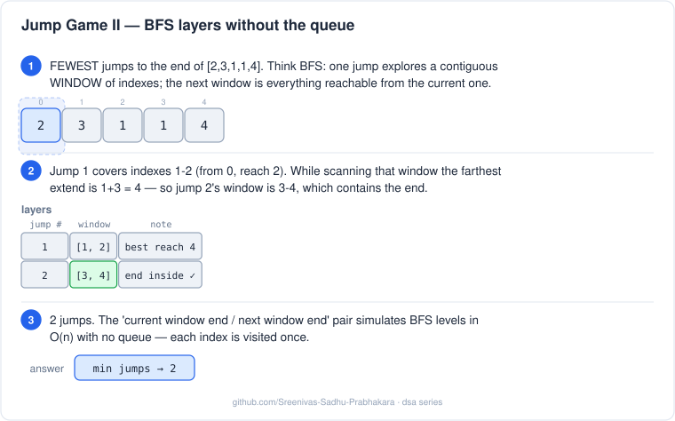

# Jump Game II

> NeetCode 150 · Greedy — BFS without a queue: the indexes reachable in j hops form a stretch, and stepping past its end is what costs a jump. Go, stdlib only, tested.

## Problem

Minimum number of hops from first to last index (hop lengths bounded by each cell's value). The counting upgrade of Jump Game.

## Approach

Think of it as BFS on the line where level j is "everything reachable in j jumps" — but since each level is a contiguous stretch, no queue is needed, just its right boundary. Scan accumulating `farthest` (the next level's boundary); upon *reaching* the current boundary, one jump is spent and the boundary advances to `farthest`. The jump is charged when leaving the level, not when choosing a target — the trick that makes greedy equal BFS here. Loop to n−2: standing on the last index must not charge a phantom jump. The unreachable case returns −1 instead of looping or lying.

**Complexity:** O(n) time, O(1) space.

## Visual walkthrough

Read the picture top to bottom — each numbered frame is one moment of the algorithm
running on this repo's test example.

## Run

    go test ./...   # verify
    go run .        # demo

---

Part of a 275-repo DSA series in Go — Striver's SDE Sheet (dsa-001–191) plus the NeetCode 150 / Blind 75 additions (dsa-192–275), stdlib only, every solution tested. Browse: [`dsa-*` repos](https://github.com/Sreenivas-Sadhu-Prabhakara?tab=repositories&q=dsa-&type=source).
